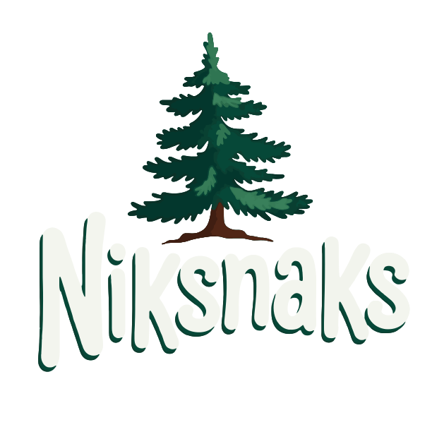

<div align="center">



# Niksnaks-browser

**A simple TV browser for Samsung Tizen, made for the remote control.**

Homepage with tiles · Ad and pop-up blocking · Remote navigation · Automatic dark mode


</div>

---

## What is it?

Niksnaks-browser is a [TizenBrew](https://github.com/reisxd/TizenBrew) module for Samsung TVs. It opens a clean homepage and adds one script to every site you visit, so websites work well with a TV remote and show fewer ads.

## Features

- **Homepage** with big tiles and a search bar, built for the remote
- **Ad, pop-up and tracker blocking** with a list of known ad domains
- **Overlay remover** that closes fake pop-ups and click-catching layers
- **Remote navigation** that jumps to the nearest link or button
- **Mini toolbar** with Home, Back, Reload and Dark mode
- **Automatic dark mode**, remembered per site
- **Per-site rules** for extra tweaks on sites that need them

## Remote keys

| Key | Homepage | Any other site |
|---|---|---|
| Arrows | Move between search and tiles | Jump to the nearest link or button, scroll when nothing is near |
| OK | Type in search / open tile | Click the selected item |
| BACK | Left to TizenBrew | Close keyboard, exit fullscreen, then go back |
| Red | | Go to the homepage |
| Yellow | | Open or close the toolbar |
| Blue | | Dark mode on or off |
| Up at the top of a page | | Opens the toolbar |

Green is used by TizenBrew for its module manager.

## Install

1. Install [TizenBrew](https://github.com/reisxd/TizenBrew) on your Samsung TV.
2. Open TizenBrew and press **Green** for the module manager.
3. Add the package `niksnaks-browser`.
4. Start it from the TizenBrew menu.

## Project layout

```
Tizenbrowser/
├── package.json        TizenBrew module info
├── docs/               the homepage (served by GitHub Pages)
│   ├── index.html
│   ├── style.css
│   ├── app.js
│   └── logo.svg
└── mods/
    └── userScript.js   injected into every page
```

## Setup for developers

1. **Homepage:** in the GitHub repo go to *Settings → Pages* and deploy from `main` and `/docs`. It will be live at `https://niksnaks3.github.io/Tizenbrowser/`.
2. **Homepage address:** if it changes, update `websiteURL` in `package.json` and `HOME_URL` in `mods/userScript.js`.
3. **Publish:** install Node.js, then run:

   ```bash
   npm login
   npm publish
   ```

4. **Update the script:** raise `version` in `package.json` and `@version` in `mods/userScript.js`, then publish again.
5. **Update the homepage:** commit and push. GitHub Pages updates within a minute.

### Check that it works

Start the module on the TV and open any tile. The toolbar should slide down for about 4 seconds. If it does, the script is injected on every site. If not, TizenBrew only injected it into the homepage.

### Test on a PC

- **Homepage:** open `docs/index.html` in Chrome. Arrow keys, Enter and Escape work like the remote.
- **Script:** add `mods/userScript.js` to the Tampermonkey extension. Use the toolbar with the mouse. Backspace works as BACK.

## Tuning

Everything is in `mods/userScript.js`:

| Setting | What it does |
|---|---|
| `AD_DOMAINS` | Ad, pop-under and tracker domains, subdomains included |
| `SITE_RULES` | Per-site CSS, default dark mode, overlay remover on or off, never-block domains |
| `AD_CSS_SELECTORS` | Ad containers hidden on every site |

The browser console logs every blocked pop-up and removed overlay with a `[Niksnaks]` prefix.

## Known limits

- Ads that load before the script runs can still download. They are hidden, but the request is not stopped like a real ad blocker would.
- `<meta refresh>` redirects in the original HTML cannot be cancelled.
- Players inside cross-origin iframes only get remote navigation if TizenBrew injects into frames. BACK always returns from the player.
- Streaming sites change their tricks often, so `AD_DOMAINS` needs updating now and then.

## License

[MIT](https://opensource.org/licenses/MIT)
